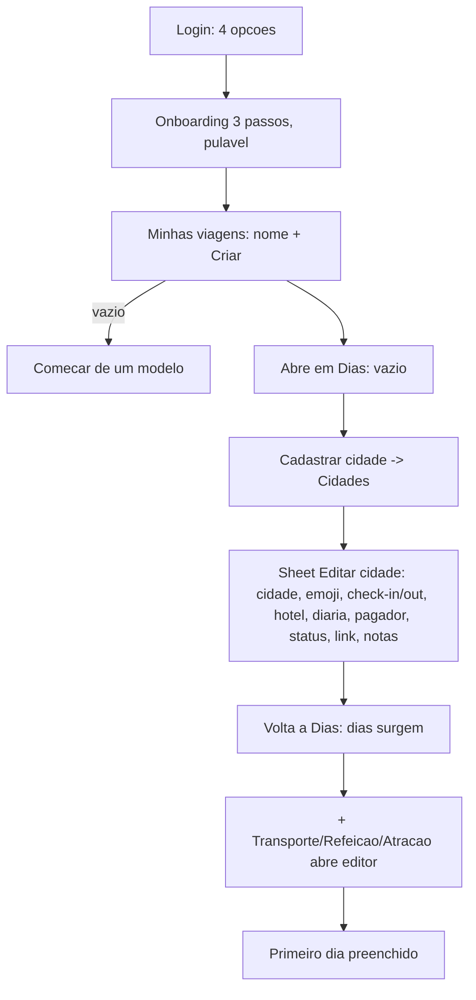
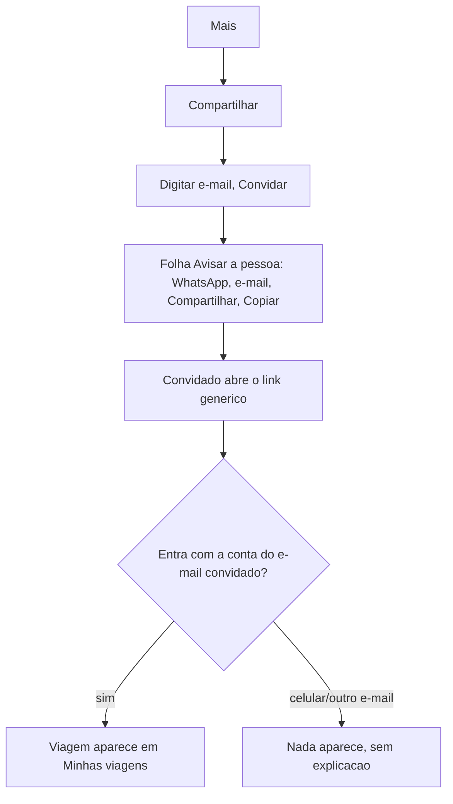
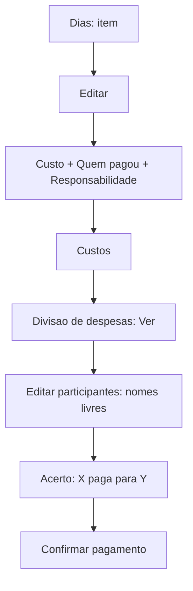

# Parecer de UX: travel-dashboard (avaliação heurística)

Data: 2026-11-09 · Método: leitura de código e documentação. O app não foi aberto, nenhum código foi executado, nenhum usuário foi ouvido.
Rótulos: `[FATO]` com caminho:linha (relativo a `src/components/` salvo indicação) · `[HIPÓTESE]` depende de ver o app rodando ou de usuários · `[RECOMENDAÇÃO]`.
Severidade: B=Bloqueador, A=Alto, M=Médio, X=Baixo. Esforço: P, M, G.

## 1. Pergunta de pesquisa e evidências

**Pergunta:** um grupo de 2 a 6 pessoas consegue montar o roteiro, controlar o orçamento e acertar as contas sem sair para planilha e WhatsApp, e onde isso trava?

**Evidência disponível:**
- `[FATO]` Não há dados de uso no repositório. `src/lib/analytics.js` define a coleta, mas nenhum relatório, exportação ou número aparece nos documentos lidos. Não afirmo nenhuma taxa.
- `[FATO]` Não há resultado da pesquisa T-1.4: `PESQUISA-ROTEIRO-T1.4.md:3-4` diz que as sessões "precisam ser conduzidas por você". Nenhum `pesquisa_usuarios_v1.md` existe no clone.
- `[FATO]` Há teste E2E (`e2e/fluxos-criticos.spec.js`, não lido a fundo): cobre fluxo técnico, não compreensão.
- `[FATO]` Só há relato do próprio autor/mantenedor nos guias de deploy (testes de aceite, não de usuários).
- Conclusão: todo o diagnóstico abaixo é avaliação de especialista. Nada foi observado em uso real.

**Aviso de documentação defasada** `[FATO]`: `DEPLOY-FASE5-ESTRUTURAL.md:16-31` descreve "Por dia (beta)", "Montar/Orçamento →", 🌈/⬛ e botão "Ver mapa". `DEPLOY-REDESIGN.md:26-27,32` diz que a aba virou Dias e que paleta e alternância foram aposentadas. No código, `screens/PorDia.jsx` só é definida, não importada (grep: única ocorrência é a definição). `screens/Mapa.jsx:35` diz "Sem tabela, sem mapa embutido". Ou seja, "Por dia (beta)" e "Montar/Orçamento" não existem mais para o usuário; avalio a navegação atual.

## 2. Avaliação do método de pesquisa existente (T-1.4)

Pontos fortes `[FATO]`: entrevista sobre a vida antes de mostrar o app (`:44-47`); tarefas sem ajuda (`:68-70`); recrutar quem não usa o app (`:31-32`); armadilhas bem listadas (`:130-141`); regra de 3+ sessões (`:140`).
Lacunas:
1. **Sem critério de sucesso por tarefa** (tempo, erros, ajuda). Só "observe". `[RECOMENDAÇÃO]` M, P: definir (ver seção 9).
2. **Tarefa 5 testa um convite que não funciona para todos** (`:90-92`, "chame sua irmã"): ver J2. Faltou checar com qual conta/e-mail a irmã entra.
3. **Sem tarefa de uso em viagem** (offline, "o que faço hoje?") nem de acerto de contas ao final. `[RECOMENDAÇÃO]` A, P.
4. **Sem teste com 2+ participantes ao mesmo tempo** (pares reais: casal, família). O produto é colaborativo e o roteiro é individual.
5. **Sem protocolo de acessibilidade** (leitor de tela, texto ampliado, uma mão). M, P.
6. **Recrutamento sem cota** para letramento digital baixo, 50+ anos e Android de entrada. `[HIPÓTESE]` de que o público real inclui esses perfis; validar.
7. Pergunta de preço (`:104`) mistura dois objetivos. Manter, mas tratar como exploratória.
8. Gravação e dados pessoais: faltam termo de consentimento e regra de guarda (LGPD). Roteiro só pede permissão verbal (`:40`). M, P.

## 3. Jornadas (a partir do código)

### J1. Primeira viagem até o primeiro dia preenchido

Fricções:
- `[FATO]` Login mostra 4 caminhos, com e-mail/senha como primário e Google secundário (`Login.jsx:113-125`). Em celular brasileiro, Google costuma ser o mais curto. `[HIPÓTESE]` M, P.
- `[FATO]` Login por celular depende do plano Blaze do Firebase e já foi observado falhando com `auth/billing-not-enabled` (`Login.jsx:18`; `DEPLOY-FASE1-COMPLETA.md:17`). `[HIPÓTESE]` o botão "Entrar com celular" pode estar quebrado em produção: A, P (verificar).
- `[FATO]` Saudação usa e-mail inteiro quando não há nome: "Olá fulano@x.com, bem-vindo…" (`TripPicker.jsx:27,76`). X, P.
- `[FATO]` O campo "Nome da viagem" e "Criar" aparecem antes do atalho "Começar de um modelo", que é um botão secundário dentro do estado vazio (`TripPicker.jsx:81-97`). Sem modelo, o usuário cai numa tela Dias vazia (`Dias.jsx:108-121`). Cadastrar cidade leva a outra aba (`Dias.jsx:115`). `[HIPÓTESE]` abandono provável aqui (Hick: muitos campos na folha da cidade; `Cidades.jsx:121-193` tem 10+ campos, incluindo pagador, rateio e link, sem relação com "começar").
- `[FATO]` Modelo cria Lisboa/Porto com hotéis e valores inventados (`TripPicker.jsx:20-21`). Não rotulado como exemplo dentro da viagem além do nome "Viagem exemplo" (`:45`). `[HIPÓTESE]` risco de o usuário não apagar dados falsos e somar com os reais. M, P.
- `[FATO]` Onboarding é sheet "Bem-vindo" com ✕ e "Pular" (`Onboarding.jsx:57,80`). Ensina "comece pelas cidades", mas não leva à ação; ao terminar a pessoa vê "Minhas viagens", não uma cidade. M, P.
- `[FATO]` Frase aleatória/citação no topo de Minhas viagens e de Dias (`TripPicker.jsx:78`, `Dias.jsx:206,505-509`): ocupa espaço de tela no topo. X, P.

### J2. Convidar e entrar numa viagem compartilhada

Fricções:
- `[FATO]` O convite só é aceito por correspondência exata de e-mail (`lib/tripData.js:169-171`: sem e-mail, `return` silencioso). Quem entrou por celular não tem e-mail (`TripPicker.jsx:27` prevê isso) e nunca recebe o acesso. Quem usa outro e-mail, idem. Não há tela "você foi convidado?".
- `[FATO]` Texto diz "e-mail da conta Google" (`ShareModal.jsx:44,127`; `lib/invite.js:25`), mas o login também aceita e-mail/senha. Orientação contraditória para quem criou conta por senha. M, P.
- `[FATO]` Convidado pelo link genérico cai na tela de login sem contexto do convite (`appUrl()` é a mesma URL; `lib/invite.js:15-18`). `[HIPÓTESE]` quem recebe pelo WhatsApp não sabe qual dos 4 botões usar. **A, M.** `[RECOMENDAÇÃO]` mensagem e tela de login devem dizer qual e-mail usar; mostrar "Não vê a viagem? Confira o e-mail com que entrou".
- `[FATO]` Convite pendente diz "Ainda não entrou no app" (`ShareModal.jsx:81`); não distingue "não abriu" de "entrou com outro e-mail". X, P.
- `[FATO]` "Remover" membro sem confirmação nem aviso ao removido (`ShareModal.jsx:68`). Só o dono convida (`:57`). M, P.
- `[FATO]` Papéis: apenas "Dono" e "Editor" (`ShareModal.jsx:66`). Sem "só leitura" (ex.: avó que só consulta). Editor pode "Limpar viagem" (`Mais.jsx:137-139` sem checagem de dono). **A, P** (ver heurística 3).
- Ponto positivo `[FATO]`: o app deixa claro que o convite não envia nada sozinho (`DEPLOY-CONVITE-ENVIO.md:26-30`) e abre a folha de envio logo após convidar (`ShareModal.jsx:32`).

### J3. Registrar e dividir despesas, acertar contas

Fricções:
- `[FATO]` Dois conceitos de "quantas pessoas": "Viajantes" (`Custos.jsx:74-89`, usado em "Por pessoa") e "participantes" da divisão (`src/domain/split.js:18-24`, nomes livres; sem ligação com membros do app). Sem participantes cadastrados, aparecem "Viajante 1…N" (`split.js:24`). `[HIPÓTESE]` confunde: M, M.
- `[FATO]` "Quem pagou" começa em "Ainda não definido" (`PaymentFields.jsx:78`). Uma despesa sem pagador fica fora do acerto; há aviso só dentro da divisão (`Custos.jsx:316-321`). `[HIPÓTESE]` o saldo parece certo e não está. **A, M.**
- `[FATO]` Registrar gasto é tarefa de planejamento ("Editar" item do dia). Não há atalho "registrei um gasto agora" (valor, quem pagou) durante a viagem. Despesa real e valor planejado são o mesmo campo "Custo" com status "Planejado/Reservado/Pago". `[HIPÓTESE]` quem quer só dividir despesas da viagem precisa passar por dia/data/cidade. **A, G.**
- `[FATO]` Rateio por percentual (`PaymentFields.jsx:92-120`); "3 e 1" vira 75/25 com aviso ("será ajustada proporcionalmente"). Para brasileiros, "quem pagou e quem consome" por pessoa ou por partes iguais é a norma; percentual é pouco natural. `[HIPÓTESE]` M, M.
- `[FATO]` Hospedagem entra como "ainda não atribuída" (`DEPLOY-FASE1-COMPLETA.md:177-178`), embora hoje `PaymentFields` apareça em `Cidades.jsx:171-175`. Confirmar com o app rodando.
- `[FATO]` Confirmar pagamento é um botão por par, "✓ Confirmar pagamento", com "Desfazer" (`Custos.jsx:343-349`). Bom. Mas qualquer editor confirma por qualquer par; sem registro de quem confirmou. M, P. Não há pagamento parcial nem PIX/chave. `[HIPÓTESE]` falta o passo final do acerto no Brasil (copiar chave PIX/valor). M, M.
- `[FATO]` Custos mostra "Por pessoa" calculado por Viajantes, não pela divisão (`Custos.jsx:68`). Dois números "por pessoa" possíveis. M, P.

### J4. Usar durante a viagem (offline, celular, dia de hoje)
Fricções:
- `[FATO]` Abre no dia mais próximo de hoje (`Dias.jsx:62-71`). Bom.
- `[FATO]` PWA com cache do app e Firestore com cache persistente (`vite.config.js:11,31`; `lib/firebase.js:36-40`). Edição offline possível.
- `[FATO]` Não há indicador "sem conexão". Só "Salvando…/Salvo" (`App.jsx:83`). Offline, `dirty` fica verdadeiro até a reconexão (`TripProvider.jsx:90-96`), ou seja, "Salvando…" indefinido. `[HIPÓTESE]` o usuário acha que há falha. **A, P.**
- `[FATO]` Falha de gravação só vai para `console.error` (`TripProvider.jsx:97-99`): "Salvando…" fica para sempre, sem mensagem nem nova tentativa visível. **A, P.**
- `[FATO]` Mapa e "Rota" abrem Google Maps (`Mapa.jsx:35,59`): exigem internet. Sem mapa offline. M, G.
- `[FATO]` Para ver o essencial do dia, o usuário vê cartão com itens e custos; horários aparecem como título "Trem · 09:00" (`Dias.jsx:266`). Reservas/anexos são link externo (📎), que abre online (`Dias.jsx:476-489`). `[HIPÓTESE]` na viagem real, o comprovante (voucher) é o que importa e não abre offline. A, G.
- `[FATO]` Lembretes são locais, só disparam com o app aberto (`DEPLOY-FASE1-COMPLETA.md:169-172`); no iPhone só com PWA instalado. M, M.
- `[FATO]` Registrar gasto na rua exige 4+ toques e um sheet longo com 8 campos (`Dias.jsx:385-466`). A, G (ver J3).
- `[FATO]` Dados abrem "dia 3 de 9", mas o cartão tem 4 botões "+" empilhados (`Dias.jsx:333-338`) antes do Stepper; em dia cheio a navegação desce. X, P.

## 4. Heurísticas de Nielsen

| # | Achado | Evidência | Sev. | Esf. |
|---|---|---|---|---|
| 1 Visibilidade | "Salvando…/Salvo" existe e é discreto (11px, cinza), mas não mostra erro nem offline | `App.jsx:83`; `TripProvider.jsx:97` | A | P |
| 1 | Presença só mostra número ("2") e os nomes ficam em `title` (some no toque e para leitor de tela) | `PresenceBar.jsx:11-20` | M | P |
| 2 Mundo real | "Versões salvas" ("Guardar ou voltar a um ponto anterior") é linguagem de software; "Carregar" não diz que troca tudo | `Mais.jsx:103`; `VersionsModal.jsx:82` | M | P |
| 2 | "Limpar viagem": o rótulo é leve, o efeito é apagar tudo para todos | `Mais.jsx:138-139` | A | P |
| 2 | "Diagnóstico: erros registrados nesta sessão", "Planilha", "Exportar/Importar JSON", "Enviar link do app" são termos técnicos para quem só quer planejar | `Mais.jsx:116-123` | M | P |
| 2 | "Custos" mistura orçamento planejado e gasto real; "Pago" é status, não gasto | `Custos.jsx:130-140` | M | M |
| 3 Controle | Excluir item, comentário, versão e membro: sem confirmação nem desfazer | `Dias.jsx:371`; `CommentThread.jsx:47`; `VersionsModal.jsx:84`; `ShareModal.jsx:68` | A | M |
| 3 | "Carregar" versão substitui a viagem inteira sem confirmar e sem salvar o estado atual antes | `VersionsModal.jsx:49-52,82` | A | P |
| 3 | "Limpar" tem folha de confirmação (bom), mas sem digitar o nome, aplicável a editor, sincroniza para todos em tempo real e a única recuperação é uma versão que talvez não exista | `Mais.jsx:166-178`; `TripProvider.jsx:299` | A | P |
| 3 | Importar JSON usa `confirm()`/`alert()` nativos e substitui tudo | `Mais.jsx:63-66` | M | P |
| 4 Consistência | Mais tem 17 linhas em 4 cartões, de importância muito diferente (Checklist ao lado de Diagnóstico) | `Mais.jsx:96-139` | M | M |
| 4 | Mesma ação, botões diferentes: "Abrir →", "Ver →", "Gerar →", "Alternar", "Ativar", "Trocar", "Sair" | `Mais.jsx:98-134` | X | P |
| 4 | "Sair" aparece duas vezes na tela de viagens e em Mais; "Renomear" usa `prompt()` do navegador | `TripPicker.jsx:67,113` | X | P |
| 4 | Ícone 📎 abre Anexos no cabeçalho e também o link de cada item, com significados diferentes | `App.jsx:87-93`; `Dias.jsx:487` | M | P |
| 5 Prevenção | Check-out antes do check-in é bloqueado com mensagem (bom) | `Cidades.jsx:142-143` | — | — |
| 5 | Banner de dias sem cidade e de sobreposição (bom) | `Cidades.jsx:35-46`; `Dias.jsx:230-234` | — | — |
| 5 | Campo Custo aceita 0 e "Quem pagou" vazio; nada avisa que o item ficou fora do acerto | `PaymentFields.jsx:78` | A | M |
| 5 | Item novo nasce vazio e já fica gravado: abrir "+ Refeição" e fechar deixa item em branco ("Sem local") | `Dias.jsx:192-200,371` | M | P |
| 6 Reconhecimento | Status por chip com menu ▾ (bom). Mas as ações no cartão são 4 botões por linha (status, Editar, 📎, 💬) com rótulos mistos | `Dias.jsx:270-273` | X | P |
| 6 | Ícones emoji sem texto (📎, 💬, 🔔 em atividade) como única pista | `App.jsx:92,99`; `ActivityFeed.jsx:32` | M | P |
| 7 Flexibilidade | Não há atalho de "gasto rápido", duplicar item, mover item de dia nem arrastar | `Dias.jsx` (ausente) | M | G |
| 7 | Importação de planilha e duplicar viagem existem (bom para o autor, `DEPLOY-PLANILHA.md`) | `Mais.jsx:116,129` | — | — |
| 8 Estética mínima | Folha de editar item: Custo + Pagamento + Rateio + Link + Status juntos | `Dias.jsx:449-460` | M | M |
| 8 | Editar cidade: 10+ campos | `Cidades.jsx:121-193` | M | M |
| 9 Erros | Mensagens de login em português claro e acionáveis (bom) | `Login.jsx:9-20` | — | — |
| 9 | Erro de rede em feedback/duplicar mostra `e.message` cru em inglês | `Mais.jsx:329,381`; `ShareModal.jsx:33` | M | P |
| 9 | Falha ao salvar a viagem: nenhuma mensagem | `TripProvider.jsx:97-99` | A | P |
| 9 | Falha ao aceitar convite: só `console.error` | `lib/tripData.js:184-186`; `store/TripsProvider.jsx:36` | A | P |
| 10 Ajuda | Onboarding de 3 passos, pulável e sem ação; não existe ajuda dentro do app ("como convidar", "como dividir") | `Onboarding.jsx:14-30` | M | M |
| 10 | Ponto positivo: textos de apoio curtos em Duplicar, Divisão, Convite | `Mais.jsx:388`; `Custos.jsx:261` | — | — |

## 5. Modelo mental: planejar × controlar

- `[FATO]` Hoje existem três lugares para ver o mesmo item: Dias (edita), Custos > Relatórios (lê: Transporte, Alimentação, Atrações, Outras, "Roteiro por dia"), e Mapa (lê paradas). `Custos.jsx:154`: "Para editar, use a tela Dias." Desktop e celular têm a mesma estrutura.
- `[FATO]` "Roteiro por dia" em Custos (`Custos.jsx:32,223-236`) repete Dias com valores, sem horários. É relatório de custo, mas o nome "Roteiro" sugere o plano.
- `[FATO]` Despesas: não há "gasto real" separado de "planejado". "Divisão de despesas" mora em Custos, mas o dado nasce em Dias.
- Avaliação `[HIPÓTESE]`: o redesign resolveu a duplicação anterior (Por dia beta vs 10 abas, `DEPLOY-FASE5-ESTRUTURAL.md:116-119`) e a separação "Dias=montar, Custos=consultar" é coerente. Mas a ponte "ver custo, ajustar item" tem 2 saltos (Custos > Relatórios > sheet de leitura > voltar > Dias > achar o dia). Há exceção: a divisão permite "Editar" o custo (`Custos.jsx:456`), o que contradiz "aqui se lê, não se edita". Duas lógicas de edição. M, M.
- `[RECOMENDAÇÃO]` Linhas dos relatórios devem abrir o item em Dias (já existe "ir para item", `App.jsx:65-68`). Renomear "Roteiro por dia" para "Custo por dia". Resolve a fricção "consultei e não sei onde mudar". M, P.
- `[HIPÓTESE]` Pessoas distintas têm dois usos: "organizador" (planeja, usa Dias/Cidades) e "participante" (consulta, paga, acerta). A navegação atende o primeiro. O segundo precisa de "hoje", "quanto devo" e "quem já pagou", que estão enterrados em Mais e Custos. Validar (P2, P4).

## 6. Colaboração (grupo de 2 a 6)

- Presença `[FATO]`: número verde no cabeçalho (`PresenceBar.jsx`). `[HIPÓTESE]` Útil para evitar edição simultânea e dar sensação de "ao vivo"; ruído baixo. Falta nome acessível e leitor de tela fala só "2".
- Edição simultânea `[FATO]`: escreve o documento inteiro da viagem com debounce de 900 ms (`TripProvider.jsx:92-100`), e adia o remoto enquanto se digita (`:60,67-85`). `[HIPÓTESE]` Duas pessoas editando itens diferentes no mesmo instante podem perder mudanças (última gravação vence o documento todo). **A, G.** Validar com 2 aparelhos (arquiteto/QA).
- Comentários `[FATO]`: por item, em Dias (`Dias.jsx:273,293,311`). **Outras despesas não têm** botão de comentário (`Dias.jsx:315-329`), embora a central de Mensagens as reconheça (`MessagesSheet.jsx:25`). Cidade/hospedagem também não. M, P.
- Mensagens `[FATO]`: lista cronológica de todos os comentários, "Ir para o item →" (`MessagesSheet.jsx:95-111`). Sem não lidas, sem notificação (`MessagesSheet.jsx:10-19`). `[HIPÓTESE]` um grupo vai continuar no WhatsApp para decidir e abrir o app só para registrar; comentário sem aviso fica sem resposta. A pergunta é validar (P3).
- Atividade `[FATO]`: só 4 tipos de evento (marcou Pago, adicionou/removeu cidade, concluiu checklist) e aparece só em Mais, 6 itens, sem filtro (`ActivityFeed.jsx:29`; `TripProvider.jsx:138,144,171,288`). Fica de fora: editar valor, excluir item, "Limpar", mudar data, remover membro. **Quem alterou o quê** não é respondido para os eventos de maior risco. A, M.
- `[FATO]` Atividade fica dentro de Mais, depois de Resumo (`Mais.jsx:94`). Ninguém abre "Mais" para saber o que mudou. `[HIPÓTESE]` baixa descoberta. M, P.
- `[FATO]` Papéis: Dono/Editor. Falta "leitor", falta indicar quem criou cada item e quem pagou na lista do dia. M, M.
- `[RECOMENDAÇÃO]` Antes de investir em chat, validar se o grupo quer ser avisado (selo "novo" no 💬 e na viagem, ou aviso por WhatsApp pelo caminho já usado no convite).

## 7. Acessibilidade vivida

- Leitor de tela:
  - `[FATO]` Sheet com `role="dialog"`, `aria-modal`, foco preso, Esc e retorno do foco (`ui.jsx:60-137`). Bom.
  - `[FATO]` Navegação principal com `aria-current` e rótulos (`App.jsx:105-116`). Bom.
  - `[FATO]` Timeline usa `role="tablist"` com botões `role="tab"`, mas sem `tabpanel` nem setas; `aria-label` só traz a data (`Timeline.jsx:24,38-41`). M, P.
  - `[FATO]` Troca de dia não anuncia o novo dia (sem `aria-live` no cartão; `Dias.jsx:209-228`). A animação respeita `prefers-reduced-motion` (`Dias.jsx:96-99`). M, P.
  - `[FATO]` Linhas de lista: `Row` com título e subtítulo, mas botões "Editar" repetidos sem o nome do item (`Dias.jsx:271,291,309,326`). Em leitor de tela são 8 "Editar" iguais. A, P.
  - `[FATO]` "Abrir →" tem `aria-label` ("Abrir Checklist"), mas "Gerar →", "Ver →", "Enviar →" não (`Mais.jsx:106,115`; `Custos.jsx:157`). M, P.
  - `[FATO]` `Row` com `onClick` usa `all: unset` num botão (`ui.jsx:45`): pode perder o foco visível. `[HIPÓTESE]` M, P.
  - `[FATO]` Toast com `role="status"` `aria-live="polite"` (`ui.jsx:212`). Bom. Erro "Salvando…" não é anunciado.
  - `[FATO]` Rótulos de campos presentes (`Field`, `Login.jsx`). Campo "Novo item" do checklist e o "Nome da viagem" só têm placeholder (`TripPicker.jsx:82-83`; `Mais.jsx:209`). M, P.
- Uma mão e alvos:
  - `[FATO]` Alvo mínimo de 44 px (`app.css:44`), mas `.btn-sm` tem 36 px (`:154`) e chips 32 px (`:215`). Em `Row`, "Editar", status, 📎 e 💬 ficam lado a lado em botões de 36 px. A, P (`[HIPÓTESE]` no aparelho).
  - `[FATO]` Barra inferior no celular (bom para o polegar, `App.jsx:105`); cabeçalho com 📎 e 💬 no topo, longe do polegar. X.
  - `[FATO]` Sheet com ✕ no topo (`ui.jsx:131`); "Concluir" no rodapé. Fechar por arrastar é citado em `DEPLOY-REDESIGN.md:73` mas não vi o código de arrastar em `ui.jsx`. `[HIPÓTESE]` só toque fora e ✕ funcionam. P.
- Texto pequeno e contraste:
  - `[FATO]` Escalas de fonte: 11/13/15/18/24 px (`app.css:34`). `.tiny` é 11 px e carrega estado "Salvo", datas relativas, rótulos da barra inferior (`app.css:108,305`).
  - `[FATO]` `--text-3` = #8e97a5 no claro e #717d8d no escuro (`app.css:16,56`), usado em textos de apoio e rótulos inativos. `[HIPÓTESE]` contraste abaixo de 4,5:1, calcular (ver NÃO VERIFICADO). A, P.
  - `[HIPÓTESE]` Fontes em px não acompanham a ampliação de texto do sistema da mesma forma que rem; testar com texto grande no Android. M.
- Swipe:
  - `[FATO]` Swipe entre dias tem alternativa: Stepper "← Anterior / Próximo →" e a linha do tempo (`Dias.jsx:340-344,207`). Bom. Dica "Arraste o cartão…" (`:347-349`) é texto de 11 px no fim da página. X.
  - `[HIPÓTESE]` Swipe horizontal no cartão compete com rolagem lateral da linha do tempo e com o gesto "voltar" do navegador/iOS. Testar.
  - `[FATO]` Stepper fica no fim do cartão, depois de todos os itens; não há "dia anterior/próximo" fixo no topo (`Dias.jsx:340`). M, P.
- Modo escuro: `[FATO]` existe (`Mais.jsx:112`, também em `TripPicker.jsx:64`), mas o padrão não segue o do sistema (`store/useTheme.js` não lido; confirmar). `[HIPÓTESE]` X.
- Linguagem simples: `[FATO]` Em geral boa. Termos a trocar: "Diagnóstico", "Planilha", "JSON", "Sobrescrever", "Carregar", "Rateio" (usado no código/doc; a tela diz "Responsabilidade pelo gasto" e "Definir percentual por pessoa").

## 8. Analytics: permitem medir a jornada?

`[FATO]` Eventos (grep `track(`): `login_succeeded`, `onboarding_started/step_completed/finished/skipped`, `trip_created`, `trip_duplicated`, `city_added`, `day_item_added`, `tab_viewed`, `expense_split_viewed`, `attachments_opened`, `messages_opened`, `message_navigated_to_item`, `attachment_opened`, `document_added`, `sheet_*`, `pdf_exported`, `reminder_*`, `feedback_*`, `list_filtered`. Chaves permitidas: 12 (`lib/analytics.js:13-26`), sem dado pessoal. Boa decisão de privacidade.

| Jornada | Dá para medir? | O que falta |
|---|---|---|
| J1 criação | Parcialmente: `login_succeeded` → `onboarding_*` → `trip_created` → `city_added` → `day_item_added` | `city_dates_completed` (cidade com datas válidas), `first_day_filled`, `trip_created` sem `blank/template` distinto de erro. Sem tempo entre passos (GA4 tem timestamp; leitura por usuário depende da configuração) |
| J2 convite | Não: nenhum evento de `invite_created`, `invite_notice_sent` (qual canal), `invite_accepted` | Os 3, mais `invite_failed_no_email` |
| J3 despesas | Só `expense_split_viewed` | `paid_by_set`, `split_customized`, `settlement_confirmed`, `unassigned_amount_shown` |
| J4 uso na viagem | Não | `app_opened_offline`, `save_failed`, `sync_pending_seconds`, `day_view_today` |
| Colaboração | `messages_opened`, sem `comment_added`, sem `presence_seen` | `comment_added`, `members` (a chave existe na lista mas nenhum `track` a usa) |
| Erros | Não | `save_failed`, `login_failed` (código do erro, categoria) |

Também faltam: `tab_viewed` não distingue primeira visita à aba; não há ID de viagem (por privacidade, correto) para agrupar sessões de uma mesma viagem. Quem quer medir "viagem com 2+ membros" precisa de `members` no evento de abertura. `[HIPÓTESE]` Firebase Analytics com usuário identificado pelo `app_instance_id` basta para funil por dispositivo; confirmar no console. `[RECOMENDAÇÃO]` M, P por evento: instrumentar os 8 eventos acima antes de qualquer teste A/B.

## 9. Personas (todas `[HIPÓTESE]`, sem pesquisa)

| Persona | Hipótese | O que validar |
|---|---|---|
| **Organizadora da família** (30 a 55 anos) | Quem puxa a viagem: planeja datas, reservas, paga hotel e passagens, depois cobra os outros. Usa celular e, às vezes, notebook | Se "coordenar" e "controlar o dinheiro" aparecem espontaneamente (T-1.4 `:59-62`); quanto do planejamento ainda acontece em WhatsApp/planilha |
| **Participante que acompanha** (família, amigos, 20 a 70 anos) | Recebe link, quer ver "o que vai ter hoje", quanto deve e a quem pagar. Quase não edita | Consegue entrar pelo convite com o e-mail certo? Abre o app durante a viagem? Quer notificação? |
| **Autor/planilhista** (usuário atual: o próprio autor, `README`/histórico Apps Script) | Domina o modelo, importa planilha, usa tudo. Viés de confirmação | Não usar como proxy do público. Comparar o que ele faz com o que um novato consegue |
| **Viajante em campo** (estado, não pessoa) | Uma mão, sol, rede ruim, ônibus. Precisa de itinerário e comprovante, e de lançar um gasto em 10 s | Se isso é de fato o momento de maior valor ou só aposta |

Restrições do público a verificar `[HIPÓTESE]`: faixa 50+ anos, baixa visão leve, Android de entrada, plano de dados limitado, pouco letramento com e-mail/senha (muitos usam só WhatsApp/celular).

## 10. Plano de validação

### 10.1 Perguntas de pesquisa prioritárias
1. **P1 (convite):** um convidado que recebe a mensagem por WhatsApp consegue chegar à viagem sem ajuda? Com qual conta tenta entrar, e quantos desistem ao não ver a viagem?
2. **P2 (primeiro uso):** quantos organizadores chegam ao primeiro dia preenchido em 10 minutos e o que fazem na tela Dias vazia e na folha "Editar cidade"?
3. **P3 (colaboração):** o grupo decide dentro do app (comentário) ou no WhatsApp? Notificação muda isso?
4. **P4 (dinheiro):** as pessoas entendem "Quem pagou", "Responsabilidade" e "Acerto" e confiam no resultado? Querem registrar gasto real durante a viagem?
5. **P5 (campo):** o que o usuário precisa em campo (offline, comprovante, "hoje") e quais ações falham com rede fraca ou uma mão?

### 10.2 Teste de usabilidade (moderado, 25 a 30 min)
Participantes: 6 a 8, em dois grupos: 3 a 4 organizadores (viajaram em grupo nos últimos 12 meses) e 3 a 4 participantes que só acompanham. Incluir pelo menos 2 com 50+ anos, 1 com baixa visão ou ampliação de texto ligada, 1 que nunca viu o app. Rodar parte em celular Android de entrada, 360 px, e parte em desktop. Rodar o teste de convite em pares (casal ou irmãos), cada um no seu aparelho. Consentimento escrito para gravar.
Roteiro curto: 3 min de contexto, 5 min de entrevista (T-1.4 Parte A, só perguntas 1, 2, 7), 18 min de tarefas, 4 min de fechamento (T-1.4 Parte C, pergunta 1 e 3).

| # | Tarefa | Sucesso | Falha / sinal de alerta |
|---|---|---|---|
| T1 | "Comece a planejar uma viagem de 10 a 14 de setembro para Porto e deixe o dia 11 com um almoço de 30 € e uma atração." | Sem ajuda, em até 8 min, dia 11 com 2 itens e custos | Ajuda pedida, ou desistiu antes de cadastrar a cidade, ou mais de 2 erros |
| T2 | "Chame sua irmã para ver e editar. Ela vai receber no WhatsApp." (a irmã, no outro aparelho, entra pelo link) | Convidada vê a viagem em até 3 min depois da mensagem, sem ajuda | Convidada não vê a viagem, entra com a conta errada, ou travou no login |
| T3 | "Você pagou o hotel; sua irmã pagou as passagens. Quem deve a quem? Registre quando ela te pagar." | Acha a divisão, define pagadores, lê o acerto correto, confirma o pagamento | Resposta de valor errada, "Quem pagou" ignorado, não acha "Divisão de despesas" |
| T4 | "Você está em Lisboa, dia 12, sem internet. Qual é o seu próximo compromisso e onde está a reserva do hotel? Registre um táxi de 15 € que você pagou." | Encontra horário e comprovante e lança o gasto offline, entende que sincroniza depois | Acha que perdeu dados, "Salvando…" interpretado como erro, não acha o comprovante |
| T5 | "Sem querer, você apagou muita coisa. Volte ao que tinha antes." (viagem preparada, com 1 versão salva e outra sem) | Descobre Versões ou entende que não há como voltar, sem apagar mais | Não acha, carrega a versão errada sem entender, ou usa "Limpar" achando que desfaz |

Métricas por tarefa: sucesso (sim/parcial/não), tempo, número de erros, pedidos de ajuda, o que a pessoa disse esperar (T-1.4 `:70`). Aplicar também SUS curto (10 perguntas) e uma pergunta de confiança nos valores ("você mostraria esse total ao grupo?"). Análise: um achado só vale com 3+ sessões (T-1.4 `:140`); falhas em T2, T3 ou T4 com 2+ participantes são prioridade.
Acessibilidade vivida: 2 sessões com TalkBack/VoiceOver (T1 e T3) e 1 com texto do sistema em 150%.

### 10.3 Hipóteses e critérios de sucesso
| Hipótese | Método | Critério |
|---|---|---|
| H1 convite falha para quem entra por celular ou por e-mail diferente | T2 + analytics (`invite_*`) | 90% dos convidados veem a viagem sem ajuda; senão, mudar fluxo |
| H2 abandono ocorre na tela Dias vazia e na folha "Editar cidade" | T1 + funil `trip_created → city_added → day_item_added` | 80% chegam ao primeiro item em 8 min |
| H3 "Quem pagou" vazio gera saldo errado percebido | T3 + `unassigned_amount_shown` | 100% identificam valor "sem pagador"; menos de 10% das despesas sem pagador após o acerto |
| H4 "Salvando…" offline é lido como falha | T4 | Menos de 2 em 8 interpretam como perda de dados após texto de estado offline |
| H5 grupo não usa comentários | Entrevista + `comment_added` por viagem com 2+ membros | Pelo menos 1 comentário em 30% das viagens com 2+ membros em 14 dias; senão, repensar como notificar |

## 11. Recomendações priorizadas (impacto esperado)

| # | Recomendação | Fricção resolvida | Sev. | Esf. |
|---|---|---|---|---|
| 1 | Mostrar erro e estado offline junto de "Salvando…" ("Sem conexão: salvo neste aparelho", "Não foi possível salvar. Tentar de novo") | `TripProvider.jsx:97-99`; J4 | A | P |
| 2 | Convite: mensagem e login dizem qual e-mail usar, aceitar convite também para quem entra por senha, avisar quando o login é por celular sem e-mail, e dar caminho "entrei e não vi a viagem" | J2, `lib/tripData.js:169-171` | A | M |
| 3 | Confirmação ou desfazer em excluir item, carregar versão e remover membro; "Limpar" só para o dono, com versão automática antes | Heurística 3 | A | M |
| 4 | "Quem pagou" ausente: aviso no item e na lista; atalho "gasto rápido" com valor e pagador | J3 | A | M a G |
| 5 | Nome acessível nos botões repetidos ("Editar almoço"), alvos de 44 px nas ações da linha, contraste de `--text-3` e do rótulo "tiny" | Seção 7 | A | P |
| 6 | Relatórios de Custos levam ao item em Dias; renomear "Roteiro por dia" | Seção 5 | M | P |
| 7 | Reorganizar Mais: "Viagem" (Checklist, Anexos, Compartilhar, Versões), "Exportar" (PDF, Planilha, JSON), "Conta" (Tema, Lembretes, Sair), "Avançado" (Diagnóstico, Limpar); mover Atividade para o topo ou para um selo | Heurística 4, seção 6 | M | M |
| 8 | Ampliar os eventos de analytics (seção 8) antes de decidir investimentos | Seção 8 | M | P |
| 9 | Onboarding que termina com uma ação ("Cadastrar primeira cidade") e modelo identificado como exemplo | J1 | M | P |
| 10 | Corrigir ou arquivar a documentação defasada (`DEPLOY-FASE5-ESTRUTURAL.md`) e código morto (`PorDia.jsx` e telas antigas) | Seção 1 | X | P |

## NÃO VERIFICADO (checklist para o Head)
- App publicado e fluxos reais: nada foi aberto. Rodar J1 a J4 em Android de 360 px e em desktop de 1280 px.
- Contraste: calcular `--text-3` (#8e97a5, #717d8d) contra os fundos (`app.css:10-60`) e rótulos 11px; WCAG pede 4,5:1 para texto pequeno (norma, conferir a versão vigente).
- Login por celular em produção (billing Blaze) e convite com conta sem e-mail.
- Salvamento: abrir a mesma viagem em 2 aparelhos, editar itens diferentes ao mesmo tempo e conferir perda; abrir em modo avião e ver o texto de estado.
- Existência real de arrastar para fechar o sheet; ordem de foco; `useTheme.js` e tema padrão.
- Leitor de tela (TalkBack/VoiceOver) em Dias, Custos e Divisão.
- Dados de uso no console do Firebase Analytics (DebugView) e se o funil por `app_instance_id` funciona.
- Se `screens/Resumo.jsx`, `Roteiro.jsx`, `PorDia.jsx` e telas antigas são código morto (confirmar com busca de imports e build).
